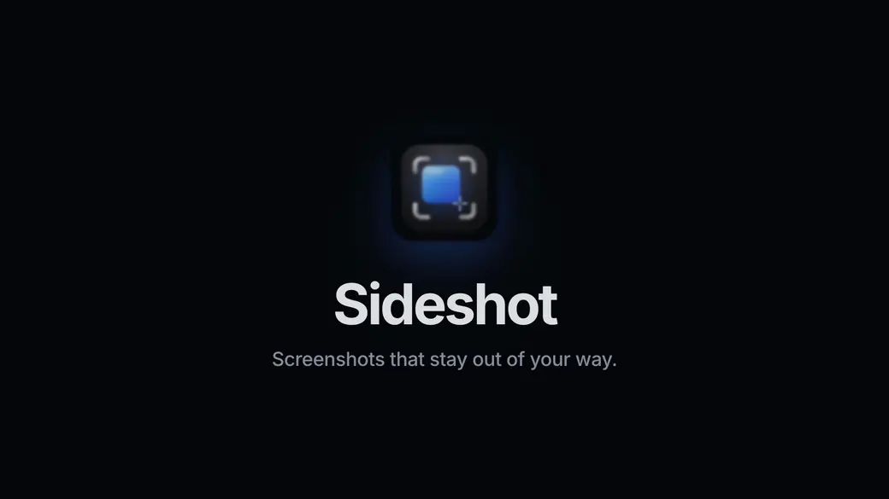

# Sideshot

A clean, native-feeling macOS menu-bar app for screenshots and screen recordings. Capture, then the result floats in a stack on the side of your screen — copy it, save it, drag it out, or trim a recording — without macOS's noisy default capture flow.

Built with **ScreenCaptureKit**, native SwiftUI/AppKit, and Carbon global hotkeys. No telemetry, no accounts, no cloud.

<p align="center">
  <a href="docs/sideshot-promo.mp4"></a>
</p>

<p align="center"><sub><a href="docs/sideshot-promo.mp4">▶ Watch the 38s promo with sound</a></sub></p>

## Features

- **Menu-bar app** — no Dock icon; lives in the status bar.
- **Global hotkeys**
  - `⌘⇧4` — capture an area (drag a clean rectangle, no crosshairs)
  - `⌘⇧3` — capture the full screen
  - `⌘⇧5` — record (screen / window / area)
  - `Esc` — cancel any in-progress capture or recording
- **Window capture** — every window dims, the one under your cursor lights up, click to snap it.
- **Floating side stack** — results stack on the screen edge (newest at the bottom). Hover to **Copy** or **Save**; drag a card out to export it anywhere.
- **Annotate** — double-click any screenshot to mark it up before sharing: selector, arrow, line, rectangle, ellipse, highlighter, freehand pen, text, **callout** (label + leader arrow), and blur (for redacting sensitive bits). Adjustable colors and three stroke widths, drag-to-move with snapping to the image centre and edges, corner resize handles, delete key, undo/redo, and live pixelation.
- **Recording** — stops into the stack as an unsaved card (nothing is saved until you say so).
- **QuickTime-style editor** — scrub and trim recordings on one strip, then **Save As…**.
- **Naming** — `SS_MMMddyy_HH.mm.png` / `SR_MMMddyy_HH.mm.mov` (e.g. `SS_Oct1826_13.05.png`), with a `_2` suffix on collisions.
- **Choose your save location** from the menu bar.

## Download

**[Download the latest release](../../releases/latest)** — unzip, then drag **Sideshot.app** into `/Applications`.

Requires **macOS 14 (Sonoma) or later**. Universal build, Apple silicon and Intel.

**Sideshot updates itself.** It checks for a new version once a day and, when there is one, adds a row at the top of its menu: *Sideshot x.y.z is available…*. No re-downloading, no update dialog to miss — everything is EdDSA-signed by [Sparkle](https://sparkle-project.org) and verified before it installs. **Check for Updates…** in the menu forces a check.

> Because the builds are locally signed (not Apple-notarized), macOS Gatekeeper complains on first launch: **right-click → Open**, then confirm. Then grant **Screen Recording** in *System Settings → Privacy & Security → Screen and System Audio Recording* — required for capture and recording. If you ever need to revoke it, quit Sideshot first, otherwise macOS may leave the entry in place.

## Releasing

`./release.sh "notes"` builds, signs the archive, writes `appcast.xml` and cuts the GitHub release. Every release must carry `appcast.xml` as an asset — the app polls `releases/latest/download/appcast.xml`, so a release without it is a 404 for every installed copy.

## Build from source

```bash
# 1. Install xcodegen
brew install xcodegen

# 2. Generate the Xcode project
xcodegen generate

# 3. Build
xcodebuild -project Sideshot.xcodeproj -scheme Sideshot -configuration Release build
```

Requires macOS 14+ and Xcode 15+.

## License

[MIT](./LICENSE)