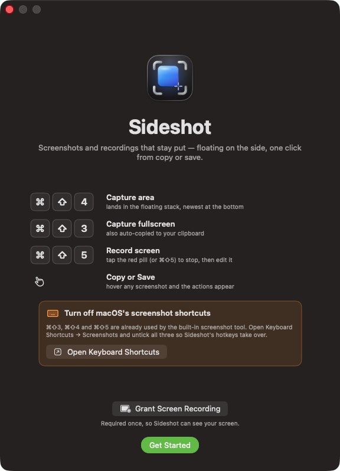
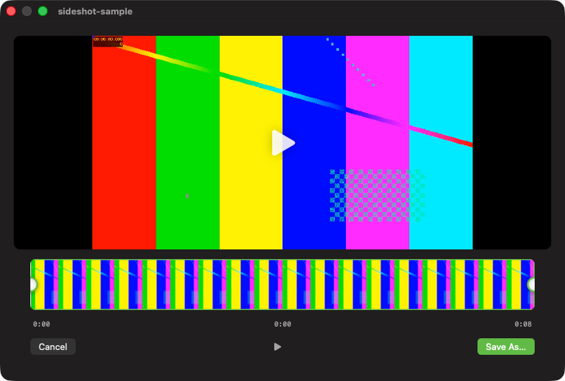

# Sideshot

A clean, native-feeling macOS menu-bar app for screenshots and screen recordings. Capture, then the result floats in a stack on the side of your screen — copy it, save it, drag it out, or trim a recording — without macOS's noisy default capture flow.

Built with **ScreenCaptureKit**, native SwiftUI/AppKit, and Carbon global hotkeys. No telemetry, no accounts, no cloud.

## Screenshots





## Features

- **Menu-bar app** — no Dock icon; lives in the status bar.
- **Global hotkeys**
  - `⌘⇧4` — capture an area (drag a clean rectangle, no crosshairs)
  - `⌘⇧3` — capture the full screen
  - `⌘⇧5` — record (screen / window / area)
  - `Esc` — cancel any in-progress capture or recording
- **Window capture** — every window dims, the one under your cursor lights up, click to snap it.
- **Floating side stack** — results stack on the screen edge (newest at the bottom). Hover to **Copy** or **Save**; drag a card out to export it anywhere.
- **Annotate** — double-click any screenshot to mark it up before sharing: arrow, rectangle, highlighter, freehand pen, text, and blur (for redacting sensitive bits). Undo/redo, keyboard shortcuts, live pixelation.
- **Recording** — stops into the stack as an unsaved card (nothing is saved until you say so).
- **QuickTime-style editor** — scrub and trim recordings on one strip, then **Save As…**.
- **Naming** — `SS_MMMddyy_HH.mm.png` / `SR_MMMddyy_HH.mm.mov` (e.g. `SS_Oct1826_13.05.png`), with a `_2` suffix on collisions.
- **Choose your save location** from the menu bar.

## Download

Grab the latest build from the [Releases](../../releases) page: unzip, drag **Sideshot.app** to `/Applications`.

> Because the builds are locally signed (not Apple-notarized), macOS Gatekeeper will complain on first launch: **right-click → Open**, then confirm. Then grant **Screen Recording** permission in *System Settings → Privacy & Security → Screen Recording* (required for capture and recording).

## Build from source

```bash
# 1. Install xcodegen
brew install xcodegen

# 2. Generate the Xcode project
xcodegen generate

# 3. Build
xcodebuild -project Sideshot.xcodeproj -scheme Sideshot -configuration Release build
```

Requires macOS 14+ and Xcode 15+.

## License

[MIT](./LICENSE)